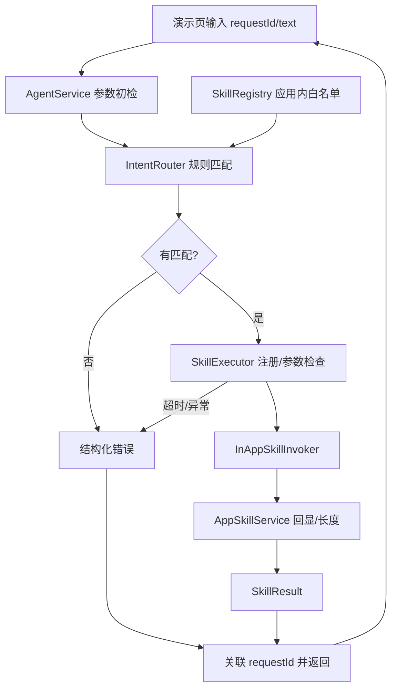
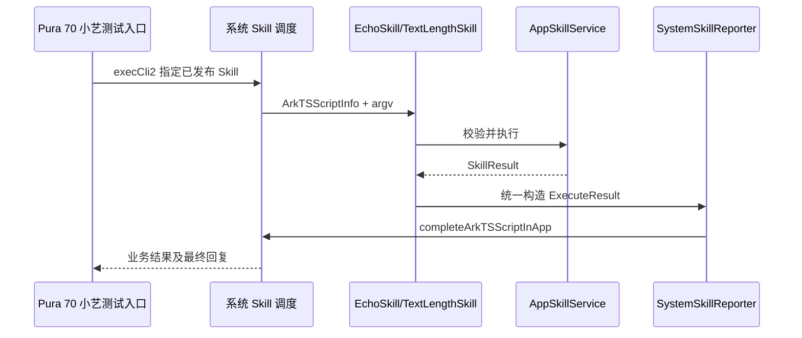
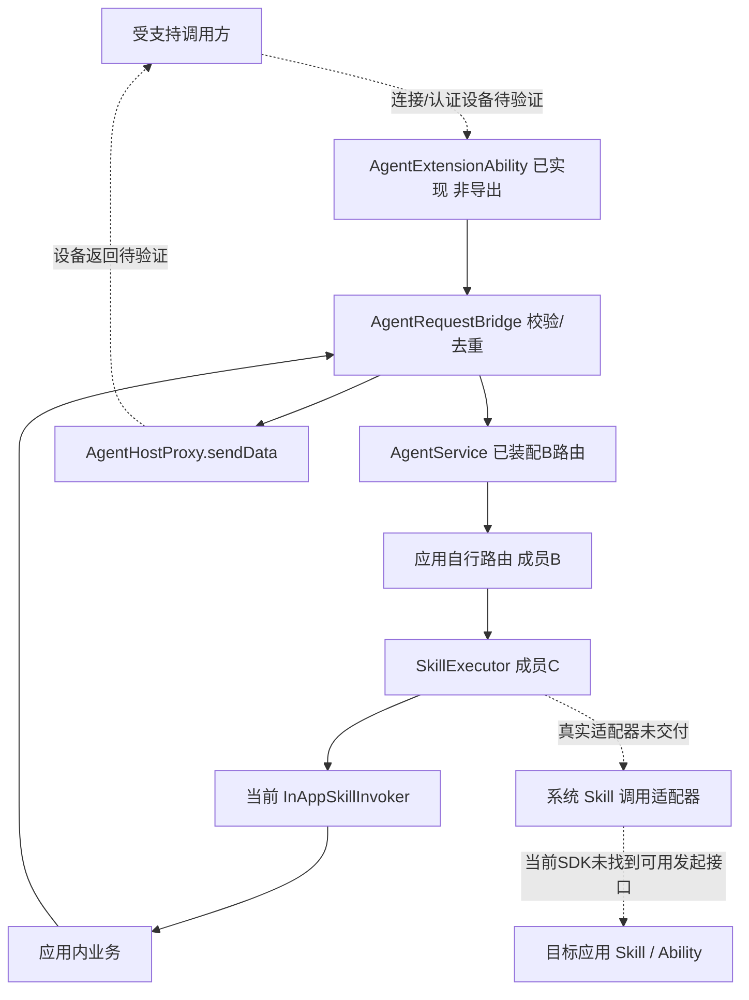
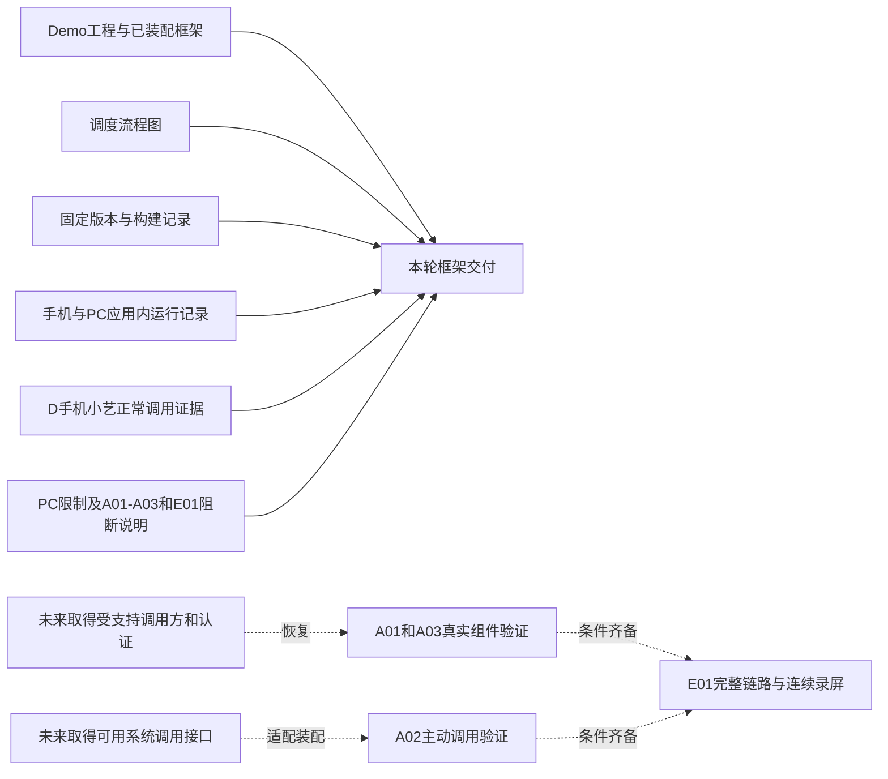

# 架构与调度流程

2026-11-08 框架交付版。当前演示页路径已有 MateBook/Pura 70 运行记录，小艺系统路径已有 D 的手机正常调用证据；组件真实连接和自建 Agent 主动系统调用仍未验证或受阻。固定版本与证据见[最终交付索引](delivery-index.md)。

## 1. 当前框架：应用内业务复用

这是当前代码的实际调用关系。规则匹配由应用实现；目录由代码显式注册。调用适配器直接复用业务，没有启动一个新 Ability，也没有运行 `srcEntries` 指向的 Skill 入口。

## 2. 手机已验证的小艺系统 Skill 正常路径

此图对应[D 的 Pura 70 真机正常调用](records/2026-11-07-D-system-skill/report.md)：源码 `ab9691f`、包名 `com.g1m1.skillagent`，两项平台注册名为 `g1-echo` / `g1-text-length`。调度、脚本入口、同 requestId 上报、小艺收到结果及屏幕回复均有证据。`execCli2` 是观察到的小艺内部调用点，不是本工程可直接使用的公共 API。

A 当前版包名为 `com.yaorz26.g1m1.skillagent`，平台注册名带 `yaorz26-g1m1-…-20261107` 前缀；这套版本的 MateBook 应用内运行通过，PC 小艺未出现测试就绪入口，不能套用手机系统调用结论。S02 无效参数系统分支也未验证；两项均不作为本轮追加补测条件。名称对应与复现方法见[换设备手册](system-skill-device-runbook.md)。

## 3. A 已装配的组件路径与目标链路

实线描述现有源码，不代表设备回调已经成功；虚线表示待实现或待验证的连接。A 的组件与桥接已编译并通过本地替身检查，真实连接、认证和回包仍未验证。[A 接入调查](records/2026-11-08-A-call-boundaries/report.md)已找到需要系统应用资格及 CONNECT_AGENT 权限的连接接口，但尚无可用的受支持调用方；[C 的 API 26 调研](records/2026-11-05-C-runtime/api-research.md)及[A SDK 复核](records/2026-11-08-A-call-boundaries/sdk-audit.json)未找到本项目普通应用可用的 Skill 发起接口。A01/A03 未验证、A02 阻断、E01 未验证并阻断归档。组件连接通道与 Skill 调度接口是两个独立前提。`skillProfiles` 是能力注册，`completeArkTSScriptInApp` 是结果上报，都不能代替发起接口。

保持三条路径的日志可辨识：`in-app`（现有本地适配器）、`system-skill`（系统脚本实际进入）、未来真实系统调用适配器定义的路径。扩展组件收到连接、系统匹配 Skill、业务执行、结果回传分别验收。

## 4. 框架交付与后续完整链路

本轮交付已有的工程、流程图、构建与运行记录。未完成的系统目标另列后续恢复条件，不阻止按约定范围交付框架：

执行步骤见[验收手册](acceptance-runbook.md)，各阶段证据入口见[交付索引](delivery-index.md)。

任务一向实验组交接 C3 的框架、应用内证据及组件/API 阻断调查；D 的小艺成功记录可作为 C2 正常路径参考，不能拼成 C3 已成功。框架暂不实现 WebView、A2A 和性能采样；实验组复用样例时须固定业务和输出契约，再单独建立受控分组。`Date.now()` 日志只用于关联请求，不能据此给出 D0/D1 性能结论。
