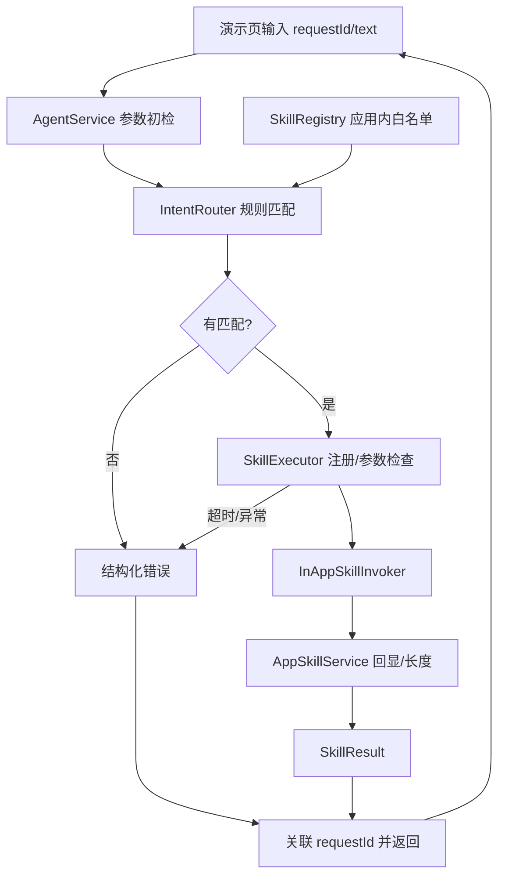
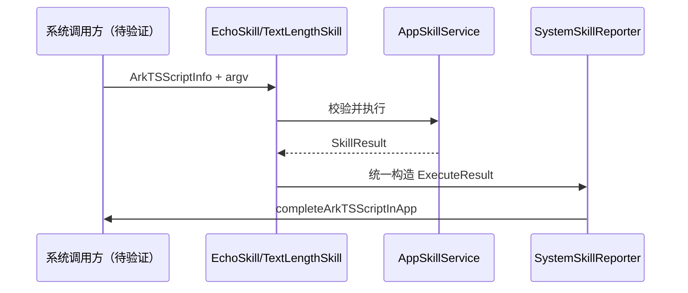
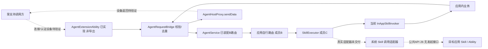
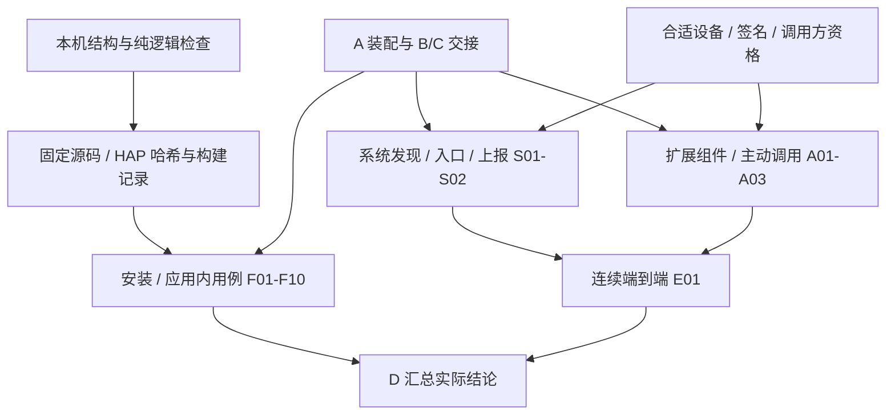

# 架构与调度流程

## 1. 当前框架：应用内业务复用

这是当前代码的实际调用关系。规则匹配由应用实现；目录由代码显式注册。调用适配器直接复用业务，没有启动一个新 Ability，也没有运行 `srcEntries` 指向的 Skill 入口。

## 2. 已放置的系统 Skill 入口源码

此图描述源码预期路径，不表示已被系统发现、匹配或执行。官方指南说明了 Skill 描述、ArkTS 入口和 `completeArkTSScriptInApp` 上报方式；系统链路需另行完成 HAP 导入及设备测试。[华为应用 Skill 开发指导](https://developer.huawei.com/consumer/cn/doc/doccenter-capabilities/arkts-skill-development-guide)

## 3. A 已装配的组件路径与目标链路

实线描述现有源码，不代表设备回调已经成功；虚线表示待实现或待验证的连接。A 的组件与桥接已编译并通过本地替身检查，真实连接、认证和回包仍未测。[A 交接](records/2026-11-04-A-integration/handoff.md)记录当前行为；[C 的 API 26 调研](records/2026-11-05-C-runtime/api-research.md)没有找到应用主动发起系统 Skill 的公共接口，A02 因此阻断。`skillProfiles` 是能力注册，不是自建 Agent 的调用 API；`completeArkTSScriptInApp` 是结果上报，不是发起调用。

保持三条路径的日志可辨识：`in-app`（现有本地适配器）、`system-skill`（系统脚本实际进入）、未来真实系统调用适配器定义的路径。扩展组件收到连接、系统匹配 Skill、业务执行、结果回传分别验收。

## 4. 和实验组的连接

D 按以下门槛组织证据；每个节点分别出结果，不把上一层通过当成下一层通过：

执行步骤见[验收手册](acceptance-runbook.md)，各阶段证据入口见[交付索引](delivery-index.md)。

任务一提供任务二 C3 的工程及逐段证据。框架暂不实现 WebView、A2A 和性能采样；若实验组复用两个样例，需要双方先固定业务和输出契约，再单独建立受控分组。`Date.now()` 日志只用于关联请求，不能据此给出 D0/D1 性能结论。
