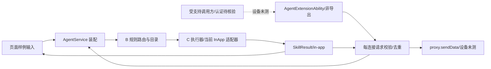

# A 交给 B/D 的接口与检查建议

此文仅为 A 的交接材料，不替 B 修改公共契约，也不替 D 宣布整体验收结论。`tools/check-core.mjs`、`tools/check-structure.mjs`、`docs/interfaces.md`、`docs/acceptance.md`、`docs/architecture.md` 均保持本轮基线 `3463f25` 的内容。

## 给 B：装配影响

- 公共 `Contracts.ets`、`TraceReporter.ets`、路由和目录源码未改动。
- A 自有 `AgentService` 构造为 `AgentService(invoker?, router?: IntentRouting, registry?: SkillRegistry)`，新增可选参数，旧调用继续可用；`supportedHint()` 从同一目录读取提示。异步 LLM 路由尚未接入。
- 组件以字符串 JSON 接收 `requestId/text`，字段限制见 [入口说明](../../../entry/src/main/ets/agentextension/README.md)。合法已接纳的 ID 每连接只允许一次执行/结果；重复消息只记录日志。组件容量满/无连接时回 `ERR_NOT_CONNECTED`，这是 A 的传输层失败，未新增到 B 的业务错误契约。
- A 增加 `agent_data_received`、`agent_duplicate_ignored`、`agent_response_sent/send_failed/dropped`、`agent_request_rejected` 等日志节点，使用已有 TraceReporter；业务仍是 `in-app`，不冒充系统 Skill。

## 给 D：独立自测与状态建议

共享 CI 继续只运行原来的结构检查与 23 项核心检查。A 的组件/装配验证在本人交付目录，D 可评估是否迁入共享工具，A 本轮不改共享检查器或工作流。

```sh
node tools/check-structure.mjs
node docs/records/2026-11-04-A-integration/check-entry.mjs
```

第二条会先运行未改动的 23 项基线，再执行 A 的 32 项自测。为避免复制 D 的加载器，它仅复用基线脚本当前注册的 ETS 加载行为，不把共享脚本当成对外 API；D 如未来改加载器，应自行调整/迁入这些用例。组件生命周期容量自测使用本地平台基类替身，仅观察组件自身逻辑，无法验证设备 IPC、proxy 身份或系统授权。

建议 D 更新 A01 为“组件/AgentCard/桥接已编译，非导出且认证/设备未测”；A03 为“A 本地桥接与模拟生命周期检查通过，真实回调未测”。A02/E01 仍未完成。这里没有改动 D 的正式验收表。

建议汇总图使用以下 A 局部流程；实线只描述代码，不证明设备成功：



此局部图留交 D 汇总，不替换 `docs/architecture.md` 的公共流程图。真机与签名、支持的连接调用方/认证、C 的真实系统 Skill 适配器仍是下一阶段前置。
