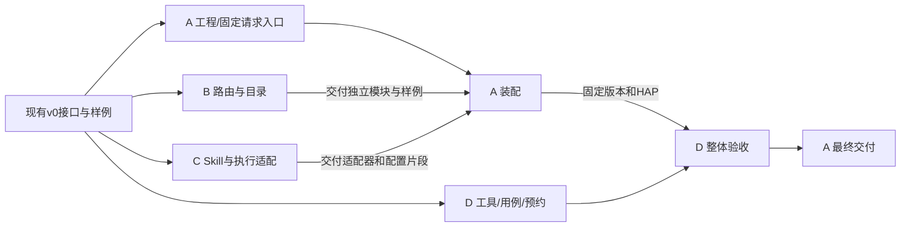

# 任务一：四人分工与交接

目标：自建一个可以调用应用 Skill 的 Agent，在 **2026-11-09（下周一）前**提交 Demo 工程、调度流程图、构建与运行记录。本表的 A/B/C/D 是成员工作包，与任务二实验编号无关。

成员 A 为 yaorz26－姚睿哲，B 的认领见 [PR #1](https://github.com/yaorz26/skill-for-harmony-G1-M1/pull/1)，C 已由李竞宇 / `lijingyuu` 认领，D 为唐欣卓 / `pourf`。各工作包独立开发、自测后按交接表接入整体工程。

## 1. 工作包与目录归属

| 成员 | 姓名 / GitHub | 独立工作包 | 主要文件 | 交付物 |
| --- | --- | --- | --- | --- |
| A | 姚睿哲 / `yaorz26` | 鸿蒙工程、UI/Agent 入口、最后装配 | `AppScope/`、构建配置、`entryability/`、`pages/`、`agentextension/`、`module.json5`；装配阶段修改 `AgentService.ets` | 构建/入口证据、装配好的 Demo |
| B | 李朝阳 / `Tomori-Saki` | 路由与能力目录 | `Contracts.ets`、`TraceReporter.ets`、`router/`、`registry/`、`docs/interfaces.md` | 路由模块、固定输入输出、独立测试记录 |
| C | 李竞宇 / `lijingyuu` | Skill 执行与系统调用适配 | `entry/skills/`、`runtime/`、`adapters/`、`service/` | 两个样例、执行器、调用可行性/适配与独立测试记录 |
| D | 唐欣卓 / `pourf` | 验收工具、证据整理与设备排期 | `tools/`、`.github/workflows/`、验收用例、模板、记录索引、设备排期；汇总流程图/运行指南 | 可独立执行的验收步骤、设备报告、最终交付索引 |

`AgentService.ets` 由 A 在装配阶段维护，B/C 不同时修改它。D 独立维护检查脚本与 CI；仓库设置变更由管理员执行。各人把本人日志放进独立记录目录，不等待 D 代写。

## 2. 共用基线：拿到任务即可开始

以仓库已经提供的 [Contracts.ets](../entry/src/main/ets/agent/Contracts.ets)、[接口文档](interfaces.md)、两个样例及 `AgentService` 接线作为 v0 基线。**先按现有接口开发，不等待其他成员重新设计接口。**

- B 使用固定请求和本地能力目录测试路由，不依赖 C 的执行结果或 A 的设备入口。
- C 使用固定 `SkillCall` 直接测试业务与 `SkillExecutor`，不依赖 B 的路由；调用入口仅遵守既有 `SkillInvoker` 接口。
- A 可先用当前样例数据完成工程构建与页面入口；扩展组件先验证固定请求的接收与返回，再接入 Agent。
- D 先基于现有样例、接口和验收表准备脚本、报告模板与设备排期，不等待成品 Demo。

接口变更在 PR 说明原因、字段变化、兼容办法和影响范围。尽量以新增可选能力替代破坏性改名；确需改动时先合入接口变更，再由下游按新接口开发。

## 3. 成员 A：工程入口与装配

独立完成：

1. 用 DevEco Studio 26.0.0 / API 26.0.0 导入工程，处理工具链、资源、签名、页面及 `EntryAbility` 问题，提交真实构建与安装记录。
2. 核实 `AgentExtensionAbility` 的版本、调用方和权限，先用固定请求验证组件回调与返回通道，不等待 B/C；能力不可用时记录阻断。
3. 保留当前 `AgentService` 接线让入口可以先用；收到 B/C 的交付后，统一修改装配位置和 `module.json5`，接入目标路由与调用适配器。
4. 完成项目综合审阅，接收 D 的验收结果，确认 Demo、流程图和记录一致，整理最终交付。

交付：`docs/records/<日期>-A-build/`、`<日期>-A-entry/` 与装配结果。仅页面启动不能代替扩展组件或真实 Skill 调用验证。

11-04 进展：[A 装配记录](records/2026-11-04-A-integration.md)。已从 `main` 接收 B 的规则路由/目录，实现并注册 Agent 组件与请求桥接、页面样例及关联日志，通过未签名构建、共享 23 项检查和 A 自有的 32 项自测。共享检查器及 B/D 的公共文档保持基线，接口影响/流程建议另交 B/D。暂时无设备；签名安装、真实连接/认证、C 真实调用装配与 D 整体验收仍待完成，不把当前部分交付标成任务一全量完成。

11-06 进展：[A 最新装配与验收交接](records/2026-11-06-A-integration.md)。从已合入 PR #7、#8 的 `main@3d89c6b` 构建固定 HAP；结构、共享核心、A 入口及 C 执行器检查通过。F08/F09 自检入口与 C 执行器已集成；API 26 未发现应用发起系统 Skill 的公共接口，真实系统调用仍受阻。当前无 HDC 设备，本轮仅完成构建与代码检查；模拟器和真机运行状态按 C 原始记录及 D 验收结果分别登记。

## 4. 成员 B：路由与能力目录

独立完成：

1. 使用 v0 的 `AgentRequest → IntentDecision`、`SkillDescriptor` 完善规则路由和目录；本周不把 LLM 接入作为前置条件。
2. 覆盖命中、未命中、缺参、超长、空白和相邻意图，使用固定输入直接调用路由测试。
3. 维护公共契约与日志字段，说明输入规范、支持指令和稳定的能力 ID。不要修改 A 的页面或 C 的业务实现。
4. 提交路由表、输入输出样例、独立测试记录及兼容性说明，形成可直接接入的交付包。

交接给 A：模块路径、接口版本、样例请求/匹配结果、通过与未通过用例。A 收到后即可接入 `AgentService`，无需再请 B 到场联合修改。

## 5. 成员 C：Skill 执行与调用适配

独立完成：

1. 用固定 `SkillCall` 跑两个无网络业务，维护 `SKILL.md`、ETS 入口、业务校验和统一回包，不等待 B。
2. 测试 `SkillExecutor` 的异常、超时和迟到结果；当前不自动重试。用可注入 `SkillInvoker` 的测试替身，不修改正式样例加入故障开关。
3. 独立核实自建 Agent 发起系统 Skill 调用的实际 API、调用方权限、可见性和返回通道。`InAppSkillInvoker` 仅作为本地基线，真实调用另写适配器。
4. 尽量先直接构建/运行 Skill；需要变更 `module.json5` 时，向 A 提交明确的注册片段、入口/方法与路径，避免两人同时改配置。
5. 提交正常与失败记录，区分业务复用、系统入口执行和系统结果上报。若有 Ability 启动，单独记录真实调用点及生命周期。

交接给 A：适配器接口/构造参数、注册片段、目标标识、权限、成功样例、失败/阻断证据。A 接到后完成配置与装配，再交 D 验收。

11-05 进展：[C 运行时记录](records/2026-11-05-C-runtime/build-record.md)。DevEco 26.0.0.865 / SDK 26.0.0.105 下未签名构建通过，F08/F09 独立检查通过；公共 API 26 未提供应用发起系统 Skill 调用的接口，A02 记录阻断，S01/S02 待设备与系统入口验证。交接说明见 [handoff](records/2026-11-05-C-runtime/handoff.md)。

11-06 进展：[C 模拟器运行记录](records/2026-11-06-C-emulator/run-report.md)。本机 API 26 模拟器（HarmonyOS 7.0.0.107）完成未签名安装与 F02–F07/F10 应用内运行时验证（13 个输入变体，含 512/513 真 emoji 剪贴板边界、F10 双请求不串包），全部通过；模拟器口径非真机。F08/F09 运行时自检入口已向 A/D 提案（待批准）；S01/S02 仍待真机。

11-06 补充：F08/F09 运行时自检入口已实现并验证（[C 自检记录](records/2026-11-06-C-selfcheck/run-report.md)）：演示页新增自检按钮，运行时注入测试替身（不碰正式样例），鸿蒙运行时 9/9 项通过，与 Node 18 项结论一致。页面 diff（`pages/Index.ets` 三处最小改动）请 A 复核；新增 `self_check_*` 日志节点待 B 评估是否入册。

11-07 收口：[C 收口说明](records/2026-11-07-C-closeout-notes.md)——S02 错误分支给出业务侧等价证据与平台输入限制分析（建议按"正常通过+错误分支阻断"登记）；A02 补入 execCli2 真机数据点（公共 SDK 26.0.0.105 零匹配，维持阻断）；A03 重复 requestId 策略自执行器视角确认。C 名下验收项全部闭环：通过项均有运行时证据，受阻项均有依据与复测路径。

## 6. 成员 D：验收工具与证据整理

独立完成：

1. 依据既有 v0 接口和 [验收用例](acceptance.md)，先维护结构/纯逻辑检查、运行报告模板与设备预约表，尽量用固定数据完成工具自测。
2. 建立独立可执行的操作步骤，明确输入、预期、证据位置与判定标准；每次真机实验一份报告。
3. B/C 独立交付并由 A 装配后，接收固定 commit/HAP，按步骤验收，不在验收阶段代改业务实现。发现问题写明首个失败节点，回交 A 安排修复。
4. 汇总调度流程图、构建运行指南、录屏与日志索引，形成最终交付材料。

D 的验收基于固定版本报告实际行为；发现问题交回对应工作包修复，重新出版本后再复测。

## 7. 必需依赖与先后顺序

| 接收人 | 依赖谁 / 何时需要 | 前置交付 | 收到后做什么 | 等待时可以做什么 |
| --- | --- | --- | --- | --- |
| B/C/D | v0 基线；开始时已具备 | 契约、样例、验收表 | 各自独立开发/准备 | 无需等待其他工作包 |
| A（装配路由） | B 完成路由后 | 代码、版本、请求/决策样例、独立测试结果 | 替换/确认 `AgentService` 路由接线 | 构建、页面、固定请求的组件验证 |
| A（装配 Skill） | C 完成执行/适配后 | 调用适配器、注册片段、权限和实测/阻断说明 | 修改配置、注入适配器、跑集成样例 | 使用现有应用内适配器验证入口 |
| C（需要注册/组件环境时） | A 完成对应环境后 | 可安装工程、注册配置、回调/权限条件 | 进行依赖系统入口的实测 | 业务、执行器及调用 API 研究独立推进 |
| D（整体验收） | A 装配 B/C 后 | 固定 commit/HAP、环境、操作步骤、已知限制 | 完成验收和报告 | 工具、模板、用例、预约与已有日志整理 |
| A（最终交付） | D 完成验收后 | 验收结果、流程图、交付索引 | 确认结论与最终交付状态 | 接收已完成的独立工作包 |

设备依赖只影响系统/真机部分；任何人遇到权限或组件限制，当天提交证据并说明后续接收人，其他工作照常推进。

## 8. 时间与交付口径（北京时间）

| 时间 | A：姚睿哲 | B | C | D |
| --- | --- | --- | --- | --- |
| 11-03 周二 | 核对工程；确认 v0 与目录分工 | 认领并直接开始路由 | 认领并直接开始业务/执行器 | 认领并准备验收步骤 |
| 11-04～05 周三/四 | 构建/页面/固定请求组件验证 | 交付路由及样例 | 交付样例/执行器；研究真实调用 | 交付工具/模板，协调设备 |
| 11-06 周五 | 接收 B/C 装配，输出固定版本 | 独立交付收口 | 完成系统实测或阻断交接 | 接收装配版本开始验收 |
| 11-07～08 周末 | 按验收问题修复/分派 | 处理分派到路由的问题 | 处理分派到执行的问题 | 补测并汇总报告 |
| 11-09 周一前 | 最终交付 | 路由说明/记录齐备 | Skill/调用证据齐备 | 流程图/验收/交付索引齐备 |

框架最低交付：源码、可复现构建说明、应用内两项能力的正常/失败演示、调度图和真实记录。更高目标为组件入口 → 自建路由 → **真实 Skill 调用** → 可观察业务/Ability → 回传；缺证据时明确“框架完成，真实调用未完成/受阻”。本周不强制引入 LLM、多步规划、WebView、Native 或 A2A。

任务二由实验组负责；本组按需交接 C3 工程与证据，不重复承担全部 A/B/C/D 对比实验。代码通过独立分支和 PR 进入 `main`，流程及实际设置状态见 [协作规则](github-workflow.md)。
